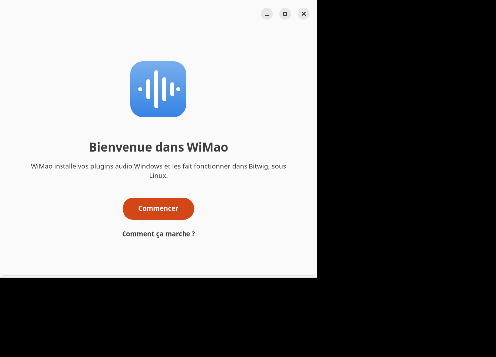
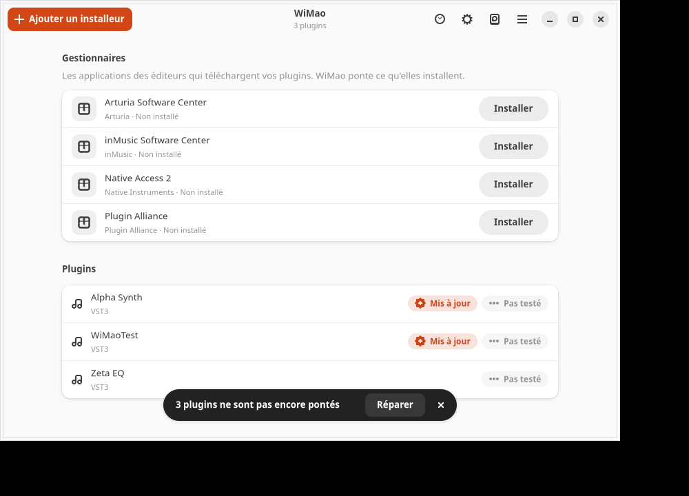
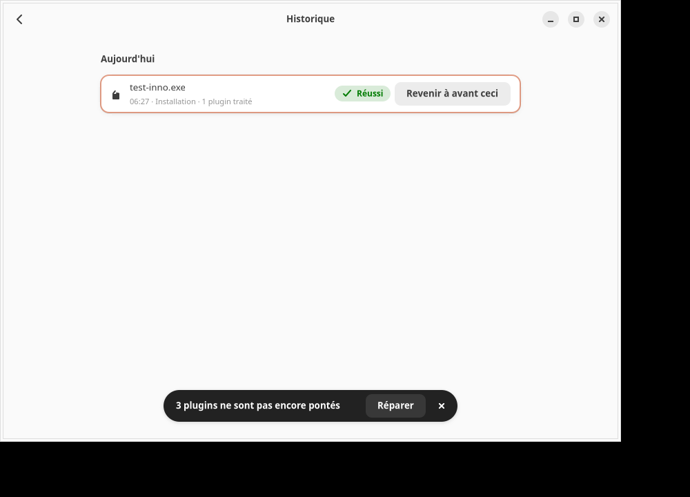

# WiMao

*[Lire en français](README.md)*

WiMao runs your Windows audio plugins (VST2, VST3, CLAP) on Linux, with no manual setup. It
prepares Wine, installs your plugins and makes them visible in your music software.

**WiMao is in beta**: it works, but you may run into bugs. Please report them!

| First-run assistant | Plugin list | History |
|---|---|---|
|  |  |  |

The screenshots show the French interface. WiMao follows your system language: English, French
and Spanish are available.

## Credits

WiMao would do nothing without other people's work. Many thanks to:

- **[yabridge](https://github.com/robbert-vdh/yabridge)**, by Robbert van der Helm (GPL-3.0 or later): it is what
  lets Linux music software load Windows plugins;
- **[Wine](https://www.winehq.org)** (LGPL-2.1 or later): it runs Windows programs;
- **[DXVK](https://github.com/doitsujin/dxvk)** (zlib license): it draws the plugin windows;
- **[Carla](https://github.com/falkTX/Carla)**, by falkTX (GPL-2.0 or later): it is used to test that plugins open.

WiMao itself is free software (GPL-3.0 or later, see `LICENSE`).

## Installation

Ubuntu 24.04 and newer, Debian 13 and newer (64-bit Intel/AMD). Copy these commands into a
terminal, one after the other:

```sh
sudo install -d -m 0755 /etc/apt/keyrings
curl -fsSL https://f1ghtc0re.github.io/WiMao/wimao.asc | sudo tee /etc/apt/keyrings/wimao.asc > /dev/null
echo "deb [signed-by=/etc/apt/keyrings/wimao.asc] https://f1ghtc0re.github.io/WiMao stable main" \
  | sudo tee /etc/apt/sources.list.d/wimao.list
sudo apt update && sudo apt install wimao
```

Fedora 44 and 45 (64-bit Intel/AMD):

```sh
sudo curl -fsSL -o /etc/yum.repos.d/wimao.repo https://f1ghtc0re.github.io/WiMao/wimao.repo
sudo dnf install wimao
```

Arch Linux and derivatives (64-bit Intel/AMD), through the AUR:

<!-- NOTE TEMPORAIRE (à supprimer à la première publication sur l'AUR, avec le sous-projet 10 terminé) : -->
> **Not available yet.** The `wimao-bin` package arrives on the AUR with its first upload. As long as
> `yay -S wimao-bin` answers "package not found", use another method.
<!-- FIN DE LA NOTE TEMPORAIRE -->

First import the signing key, then check that its fingerprint is
`3980 C3D2 0A17 566A 075A 65CB CB97 DE3F BF41 DD46`:

```sh
curl -fsSL https://f1ghtc0re.github.io/WiMao/wimao.asc | gpg --import
yay -S wimao-bin
```

Read the recipe (`PKGBUILD`) before building it: `yay` shows it to you. Without `yay`:
`git clone https://aur.archlinux.org/wimao-bin.git && cd wimao-bin && makepkg -si`.
Removal: `sudo pacman -R wimao-bin`.

WiMao then updates along with the rest of your system. The security checks (key fingerprint,
signatures), a missing `curl`, Fedora and SELinux, Arch Linux, and removing the repositories are
explained in the [detailed installation guide](docs/installation-detaillee.md) (in French).

## First steps

1. Start **WiMao** from the applications menu: the assistant takes care of the rest.
2. Add a plugin with "Add an installer", or open your vendor's manager (Native Access, Arturia
   Software Center, inMusic Software Center, Plugin Alliance).
3. In your music software, add the folders `~/.vst3`, `~/.clap` and `~/.vst/yabridge`.
4. Rescan your plugins: yours show up. The user guide is built into WiMao (F1 key).

## Learn more

- [User guide](crates/wimao/aide/en/): also in WiMao, F1 key;
- [Detailed installation](docs/installation-detaillee.md) (in French): checks, Fedora, building from source, command line;
- [SECURITY.md](SECURITY.md) (in French): reporting a vulnerability, verifying a release;
- [CONTRIBUTING.md](CONTRIBUTING.md) (in French): taking part in the project. Issues may be written in English;
- [LICENSE](LICENSE): GPL-3.0 or later.
