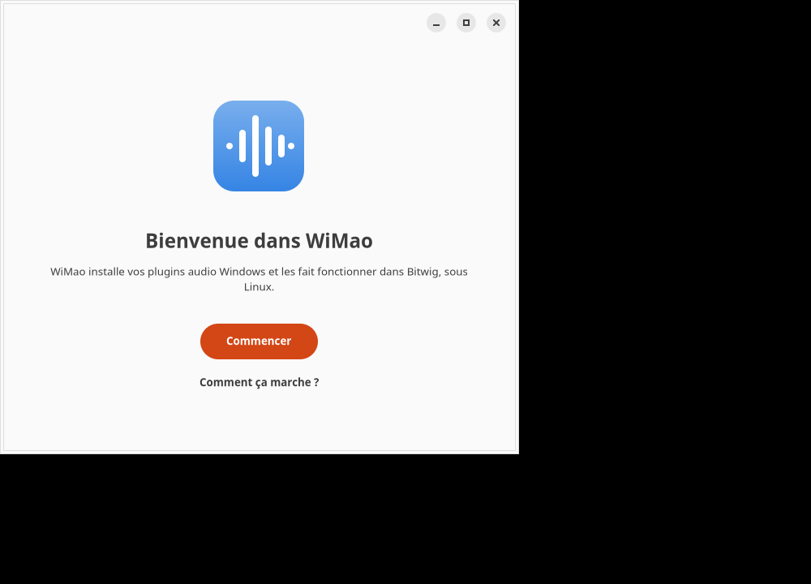
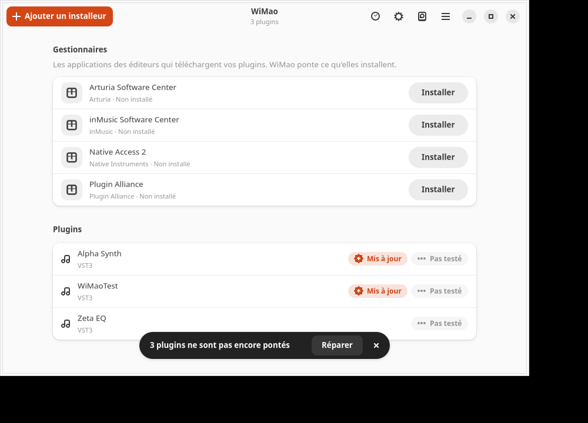
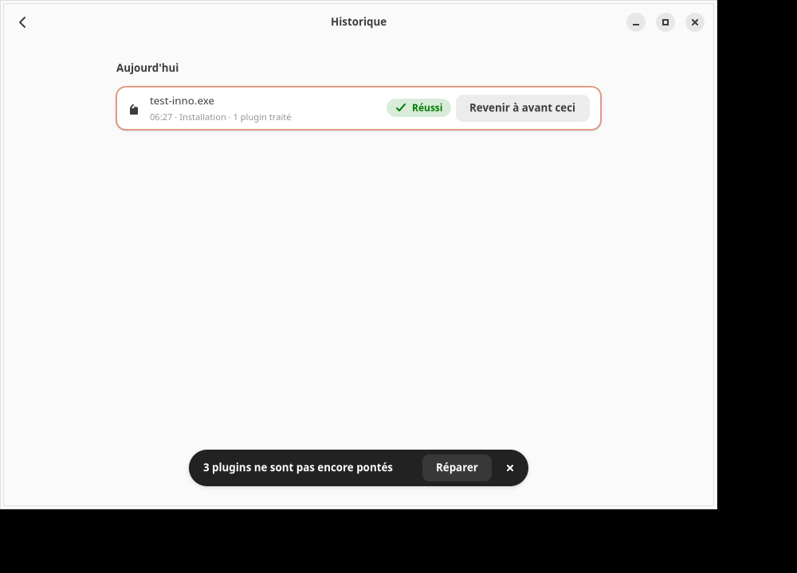

# WiMao

WiMao fait tourner des plugins audio Windows (VST2, VST3, CLAP) sous Linux, avec
Wine et yabridge, sans que vous ayez à configurer quoi que ce soit à la main :
il crée l'environnement Wine, installe vos plugins, les « ponte » vers votre
station audio (DAW) et vérifie qu'ils fonctionnent.

**État du projet : en développement.** Le noyau (environnement Wine, installation
avec recettes, pontage yabridge, test d'ouverture, sauvegarde, diagnostic, historique des
actions, import d'un environnement existant), la ligne de commande `wimao-cli` et une interface
graphique (GTK4 + libadwaita) existent, et trois paquets Debian sont publiés (version 0.5.0, avec un
dépôt `apt` signé : voir « Installation »). Le journal des essais est dans `NOTES.md`, la
conception dans `docs/superpowers/specs/`.

## Aperçu

| Assistant de premier lancement | Liste des plugins | Historique |
|---|---|---|
|  |  |  |

L'interface suit le thème clair ou sombre du système (version sombre :
[`docs/captures/sombre-liste.png`](docs/captures/sombre-liste.png)).

## Mode d'emploi

Le mode d'emploi est intégré à l'interface (menu principal, ou touche F1) : neuf chapitres en
français, anglais et espagnol (sources : `crates/wimao/aide/`). Il couvre le premier lancement,
l'ajout d'un plugin, les gestionnaires d'éditeurs, l'utilisation des plugins dans votre logiciel de
musique, la réparation, l'historique, la sauvegarde, l'import et les problèmes fréquents.

**Importer un environnement existant.** Si vous avez déjà un `~/.wine-mao`, l'assistant (ou
`wimao-cli importer`) propose de le reprendre : vous le lancez vous-même ; WiMao le déplace sans
rien copier et laisse un lien à l'ancien emplacement, et l'import est annulable
(`wimao-cli importer --annuler`).

**Historique.** Chaque installation, réparation, sauvegarde, restauration, import ou retour en
arrière est noté. La page « Historique » (Ctrl+H) ou `wimao-cli historique` les liste, et un
retour en arrière est proposé pour les actions qui ont un point de restauration.

## Installation

WiMao s'installe avec trois paquets Debian (`.deb`), publiés dans un dépôt `apt` signé et dans les
« Releases » du dépôt GitHub. Ils fonctionnent sur **Ubuntu 24.04 et plus récent** et **Debian 13 et
plus récent**, en **64 bits Intel/AMD (amd64)** seulement.

| Paquet | Contenu |
|---|---|
| `wimao-wine` | Wine 11.20 avec le correctif nécessaire aux fenêtres de plugins, dans `/opt/wimao/wine` (le Wine de votre système n'est pas touché) |
| `wimao-bridge` | yabridge 5.1.1 (`/opt/wimao/yabridge`) et DXVK 3.1.1 (`/opt/wimao/dxvk`) |
| `wimao` | l'interface `wimao`, la ligne de commande `wimao-cli`, les recettes, les traductions |

### Méthode 1 (recommandée) : le dépôt `apt`

Avec cette méthode, WiMao se met à jour avec le reste du système (« Mises à jour de logiciels » ou
`sudo apt upgrade`). Si `curl` n'est pas installé (c'est possible sur un système neuf, Debian 13 notamment) :
`sudo apt install curl`. Sans `curl`, la clé téléchargée serait vide et `apt update` échouerait avec une erreur
de signature. Copiez ensuite ces quatre commandes dans un terminal, l'une après l'autre :

```sh
sudo install -d -m 0755 /etc/apt/keyrings
curl -fsSL https://f1ghtc0re.github.io/WiMao/wimao.asc | sudo tee /etc/apt/keyrings/wimao.asc > /dev/null
echo "deb [signed-by=/etc/apt/keyrings/wimao.asc] https://f1ghtc0re.github.io/WiMao stable main" \
  | sudo tee /etc/apt/sources.list.d/wimao.list
sudo apt update && sudo apt install wimao
```

Ce que font ces commandes : la première crée le dossier des clés, la deuxième y place la clé publique
de WiMao, la troisième déclare le dépôt (`signed-by` limite la confiance de cette clé à ce seul
dépôt), la quatrième installe `wimao` et ses deux dépendances (`wimao-bridge`, `wimao-wine`).

**Comparez l'empreinte de la clé** avant de lui faire confiance (`gpg --show-keys --fingerprint
/etc/apt/keyrings/wimao.asc`). Elle doit être exactement :

```text
3980 C3D2 0A17 566A 075A  65CB CB97 DE3F BF41 DD46
```

C'est aussi celle de `SECURITY.md` ; mieux vaut la lire sur une autre source que ce site (par
exemple le dépôt GitHub). `apt` refuse alors le dépôt si un seul octet de l'index ou d'un paquet a
été modifié. Pour revenir à une version précédente : `sudo apt install wimao=<version>`. Pour
retirer le dépôt : `sudo rm /etc/apt/sources.list.d/wimao.list /etc/apt/keyrings/wimao.asc`.

**Si `apt update` signale un jour `EXPKEYSIG` pour le dépôt WiMao**, la sous-clé de signature a été
prolongée et votre copie de la clé publique est périmée : relancez simplement la deuxième commande
ci-dessus (`curl … | sudo tee /etc/apt/keyrings/wimao.asc`). L'empreinte ne change pas ; vérifiez-la
de nouveau comme ci-dessus.

### Méthode 2 : télécharger les `.deb` et les vérifier soi-même

Pour qui préfère tout contrôler à la main, sans ajouter de dépôt (pas de mises à jour automatiques).

1. Téléchargez, depuis la page de la Release, les trois `.deb` ainsi que `SHA256SUMS` et
   `SHA256SUMS.asc` dans un même dossier.
2. Vérifiez-les. La clé publique de signature est publiée dans `docs/cle-publique.asc` : prenez-la dans une copie du dépôt (`git clone`) ou téléchargez-la à
   l'adresse `https://raw.githubusercontent.com/F1ghtc0re/WiMao/main/docs/cle-publique.asc`, puis
   comparez son empreinte (`gpg --show-keys --fingerprint docs/cle-publique.asc`) avec celle de
   `SECURITY.md` :

   ```sh
   gpg --import docs/cle-publique.asc         # une seule fois
   gpg --verify SHA256SUMS.asc SHA256SUMS     # la liste d'empreintes est bien signée
   sha256sum -c SHA256SUMS                    # les .deb correspondent à cette liste
   ```

   Le détail, y compris la vérification de la provenance (`gh attestation verify`), est dans
   `SECURITY.md`, « Vérifier une version ».
3. Installez :

   ```sh
   sudo apt install ./wimao*.deb
   ```

   `apt` choisit tout seul l'ordre (`wimao` dépend des deux autres) et tire les bibliothèques
   nécessaires depuis votre distribution.

**Carla (test d'ouverture des plugins).** `carla` et `x11-utils` sont seulement *recommandés* :
`apt` les installe par défaut. Carla n'existe pas dans Debian 13 : sur ce système l'installation
réussit, WiMao fonctionne (environnement Wine, installation, pontage yabridge), mais le test qui
ouvre chaque plugin est désactivé et le dit clairement. Installez Carla vous-même (hors dépôts
Debian) si vous voulez ce test.

**Vos données.** Désinstaller les paquets (`sudo apt remove wimao wimao-bridge wimao-wine`) ne
supprime jamais votre environnement Wine ni vos plugins (`~/.local/share/wimao/`). Au premier
lancement, WiMao crée le lien `~/.local/share/yabridge` vers `/opt/wimao/yabridge` s'il n'existe
pas ; s'il existe déjà (lien ou dossier), il n'y touche pas. Si ce lien mène ailleurs (un autre
yabridge, un dossier disparu), « Diagnostiquer » vous le signale avec la commande à lancer pour utiliser
celui de WiMao : le changement reste votre décision.

Fabriquer les paquets soi-même, et comprendre comment on s'assure qu'ils sont reproductibles :
`paquets/README.md`. Publier une version (pour le propriétaire du dépôt) :
`docs/publier-une-version.md`.

## Gestionnaires et installeurs pris en charge

Les recettes fournies sont dans `recettes/` (format : `docs/recettes.md`) :

| Produit | Type | Remarque |
|---|---|---|
| Native Access 2 (Native Instruments) | gestionnaire | lien de connexion `native-access://` relayé vers Wine |
| Arturia Software Center | gestionnaire | |
| inMusic Software Center (AIR…) | gestionnaire | ses installeurs sont relancés en silencieux par le pilote |
| Plugin Alliance (Installation Manager) | gestionnaire | peut se figer à 98 % : le fermer alors |
| Serum 2 (Xfer Records) | installeur | activation par le compte Xfer |
| Valhalla Supermassive | installeur | gratuit |

Licence : GPL-3.0 ou ultérieure (voir `LICENSE`).

## Compiler et tester en 5 commandes

Il faut Rust (via <https://rustup.rs>), `gettext` (compile les traductions) et, pour
l'interface graphique, GTK 4 et libadwaita. Les tests appellent aussi `7z`, `Xvfb`,
`xwininfo` et `cabextract`. Sur Debian/Ubuntu :

```sh
sudo apt install gettext 7zip xvfb x11-utils cabextract libgtk-4-dev libadwaita-1-dev
```

Pour faire fonctionner des plugins, il faut en plus le Wine et le yabridge de WiMao (voir
`CONTRIBUTING.md`, « Préparer sa machine » et « Tests d'intégration avec Wine »).

```sh
git clone https://github.com/F1ghtc0re/WiMao.git
cd WiMao
cargo build
cargo test
cargo run -p wimao-cli
cargo run -p wimao        # l'interface graphique
```

## Exemples d'usage (ligne de commande)

```sh
wimao-cli init                                  # crée l'environnement Wine de WiMao
wimao-cli detecter Setup.exe                    # reconnaît le type d'un installeur
wimao-cli installer Setup.exe                   # installe, ponte et teste les plugins
wimao-cli verifier                              # rouvre chaque plugin ponté (✅/⚠️/❌)
wimao-cli diagnostiquer && wimao-cli reparer    # cherche puis répare les défauts
wimao-cli restauration lister                   # points de restauration
wimao-cli historique [--tout]                   # dernières actions (installations, réparations…)
wimao-cli sauvegarder /media/disque             # sauvegarde (puis `restaurer fichier.sha256`)
wimao-cli importer                              # reprend ~/.wine-mao dans WiMao (déplacement, lien laissé)
wimao-cli importer --annuler                    # remet l'environnement dans ~/.wine-mao
wimao-cli installer Setup.exe --oui             # sans question avant de fermer les programmes ouverts
wimao-cli --langue en rapport                   # rapport anonymisé à joindre à un signalement
```

Codes de sortie : 0 succès, 1 erreur, 2 au moins un plugin ❌.

## Pour aller plus loin

- `ARCHITECTURE.md` : comment le code est organisé, fichier par fichier ;
- `paquets/README.md` : fabriquer, tester et vérifier les paquets Debian ;
- `docs/publier-une-version.md` : publier et signer une version (propriétaire du dépôt) ;
- `SECURITY.md` : signaler une faille, vérifier une version ;
- `CONTRIBUTING.md` : préparer sa machine, lancer les tests, conventions, ajouter une recette,
  une chaîne traduisible, une règle d'erreur ou une langue ;
- `NOTES.md` : journal des essais sur Wine et les plugins ;
- `docs/ameliorations-reportees.md` : petits défauts connus à corriger, et décisions prises
  pendant le développement (à lire avant de les remettre en cause).

Les scripts du dossier `scripts/` sont l'ancienne installation en shell ; ils
seront remplacés par WiMao.
